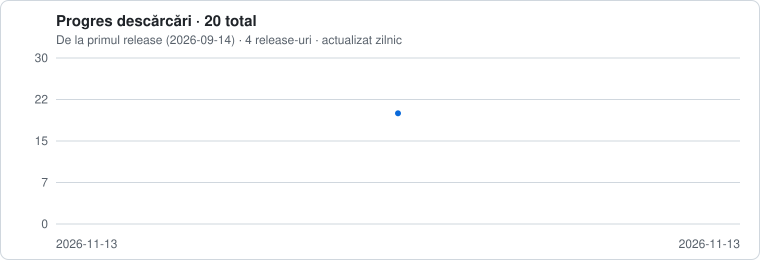
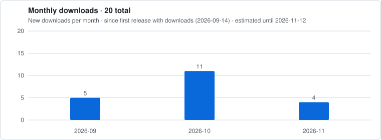
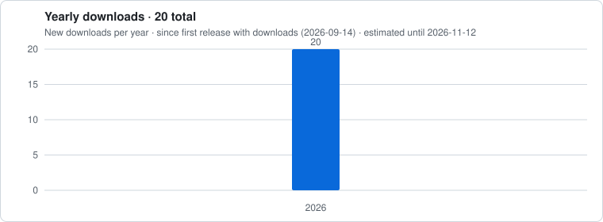
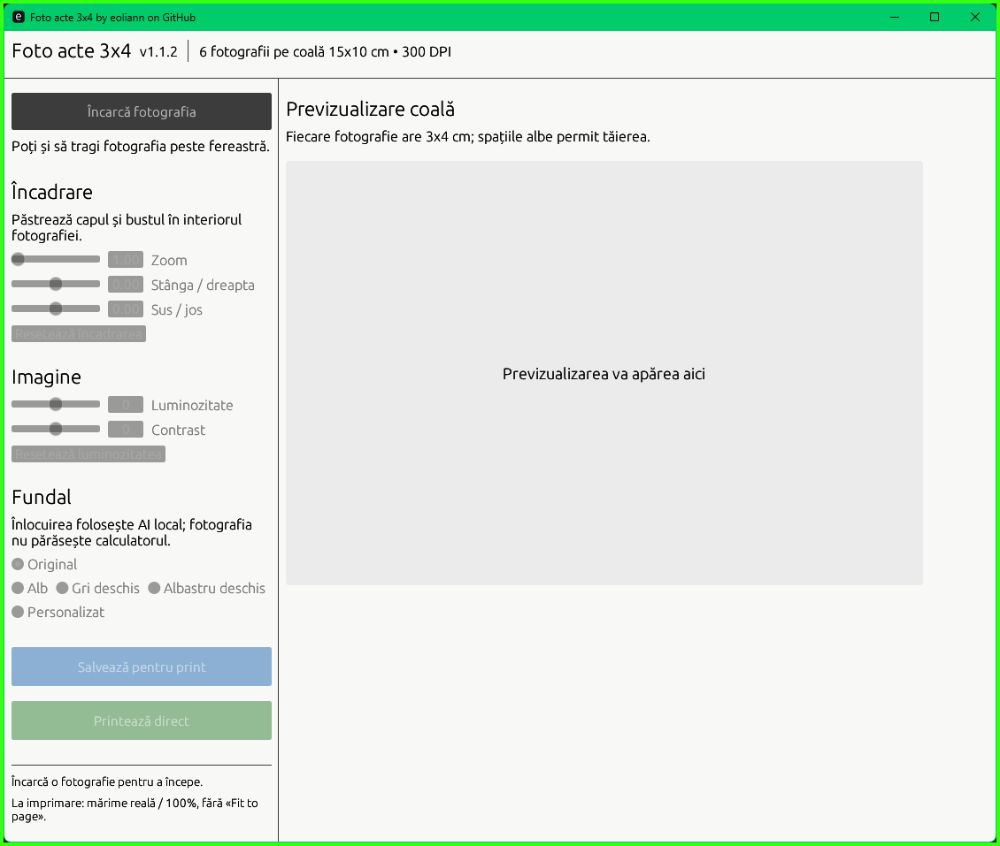
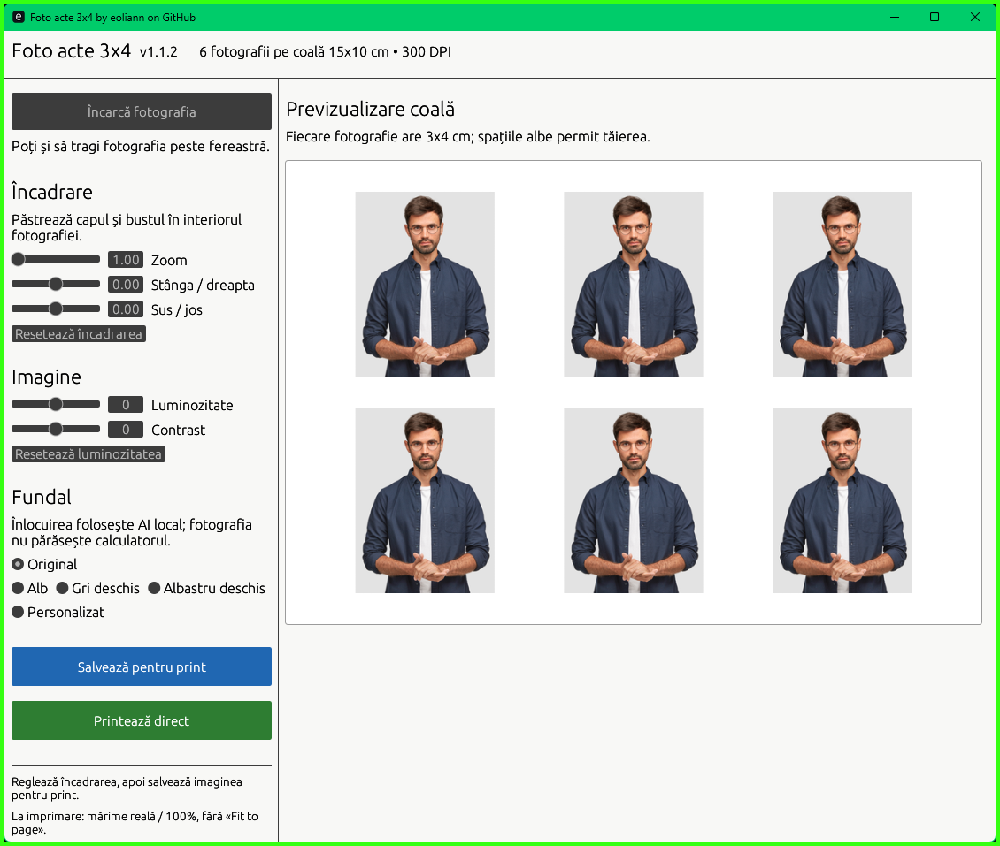
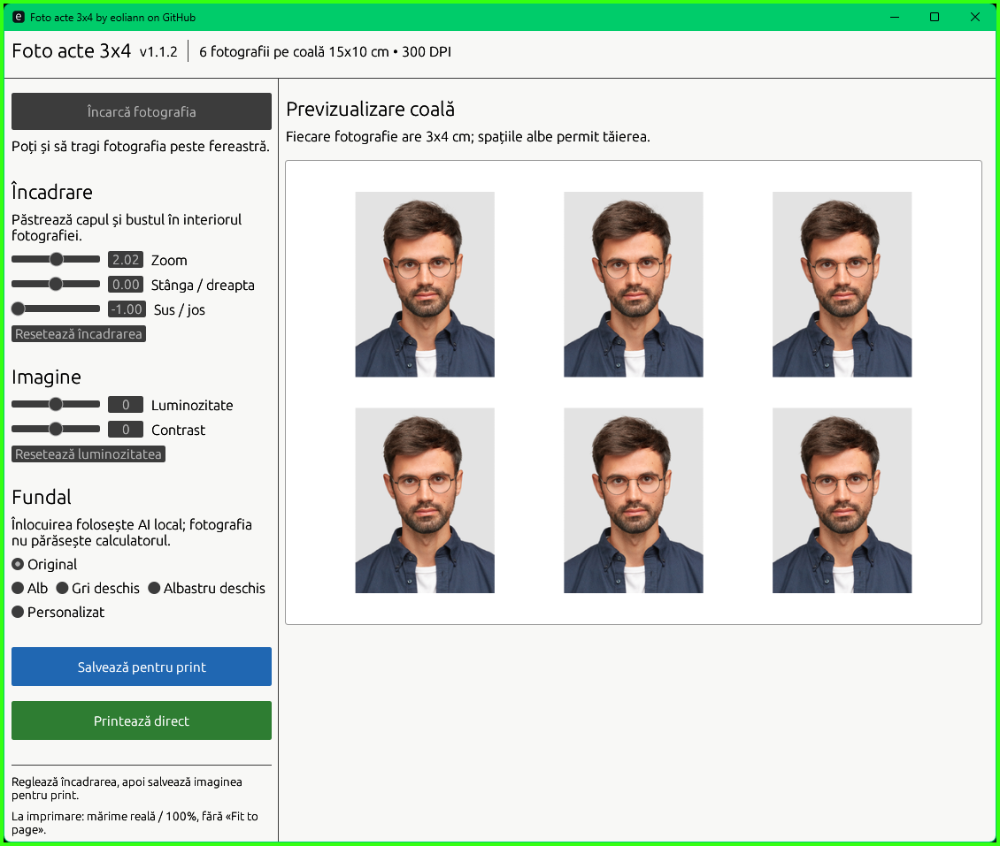
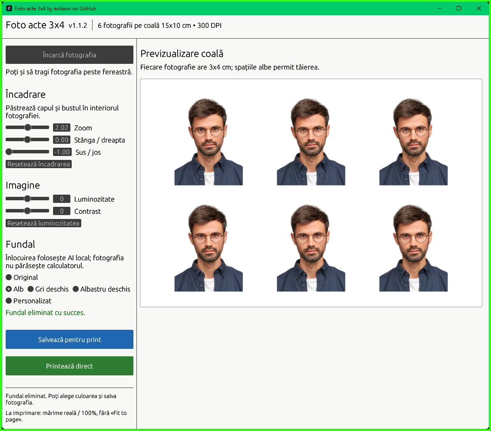
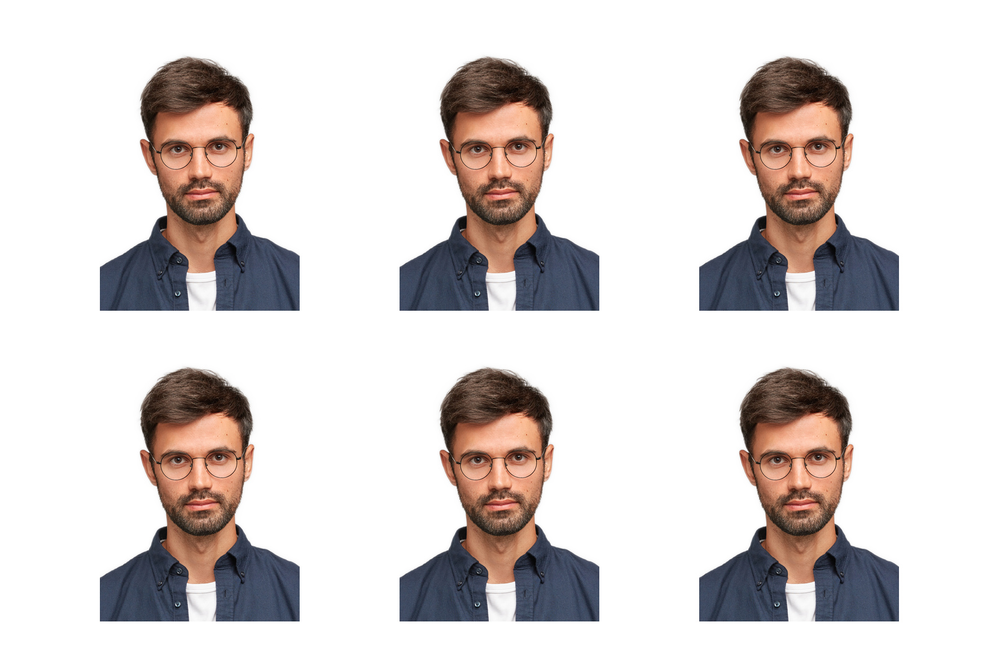
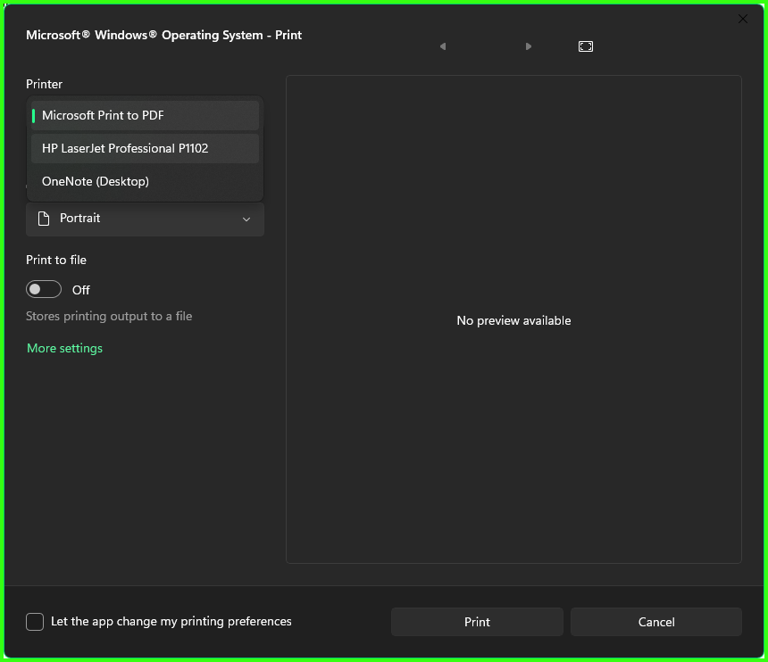

[](https://www.paypal.com/donate/?hosted_button_id=PTH2EXUDS423S)
[](https://revolut.me/adriannm9)
[](https://ko-fi.com/eoliann)


[](https://github.com/eoliann/Foto-acte-3x4/releases/latest/download/Foto-acte-3x4.exe)


[](LICENSE.md)

<details open>
<summary><b>Downloads · daily (cumulative)</b></summary>



</details>
<details>
<summary><b>Downloads · monthly</b></summary>



</details>
<details>
<summary><b>Downloads · yearly</b></summary>



</details>


# Foto acte 3x4

A portable, offline Windows desktop app that arranges a photo into 6 copies of 3x4 cm on a 15x10 cm photo sheet.

## Features

- JPEG export of 1772x1181 pixels at 300 DPI;
- six photos of 354x472 pixels, about 3x4 cm each;
- manual zoom and position adjustment for precise framing;
- brightness and contrast adjustment;
- AI background removal, fully offline;
- white, light gray, light blue or any custom color from the palette as background;
- sheet preview before saving;
- loading through a file picker or drag-and-drop;
- EXIF orientation correction for photos taken with a phone;
- fully local processing, the photo is never uploaded to the internet.

## Gallery

<p align="center">
  
  
</p>
<p align="center">
  
  
</p>
<p align="center">
  
  
</p>

## Download

Download the Windows archive from the [Releases](../../releases/latest) page, extract `Foto-acte-3x4.exe` and start the app. The executable needs no installation and no Rust on the user's computer.

Windows may show a SmartScreen warning for new executables that are not digitally signed. Make sure the file comes from the Releases page of this repository.

## Usage

1. Open `Foto-acte-3x4.exe`.
2. Load the photo or drag the file onto the window.
3. Adjust the zoom and position until the head and shoulders are framed correctly.
4. Adjust brightness and contrast, remove and set the background.
5. Click **Save for print** (*Salvează pentru print*).
6. Print the JPEG at **100% / Actual size**, without the `Fit to page` option.

The app does not detect or modify the face automatically. Manual framing keeps the result predictable and lets you adapt to each photo.

To replace the background, pick one of the predefined colors or the **Custom** (*Personalizat*) option. The first AI processing can take a few seconds, depending on the processor; all later adjustments are shown immediately.

## Supported formats

JPEG, PNG, WebP and BMP are accepted as input. The result is saved as JPEG with 300 DPI metadata.

## Development

[Rust](https://www.rust-lang.org/tools/install) 1.94 or newer is required.

```powershell
cargo run
```

Local checks:

```powershell
cargo fmt -- --check
cargo test --locked
cargo clippy --locked --all-targets -- -D warnings
```

## Portable build

From PowerShell run:

```powershell
.\build-portable.ps1
```

The standalone executable will be created at `dist\Foto-acte-3x4.exe`.

## Publishing a release

The GitHub Actions workflow builds and tests the project on every push and pull request. A tag of the form `v1.1.2` automatically creates a GitHub Release containing the Windows archive:

```powershell
git tag v1.1.2
git push origin v1.1.2
```

## Technologies

The interface is built in Rust with `eframe/egui`, image processing uses the `image` crate, and background removal uses the MODNet model through the `RTen` runtime.

The AI model is embedded in the executable and distributed under the Apache-2.0 license. Its provenance and license are documented in [`assets/README.md`](assets/README.md).
